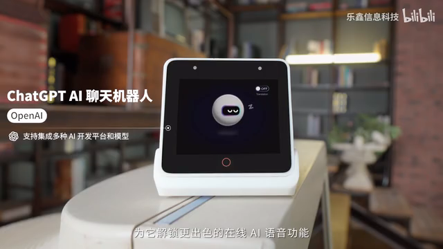
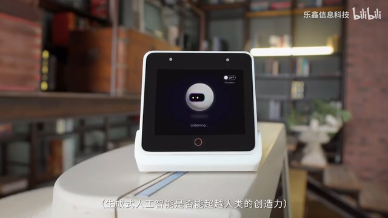
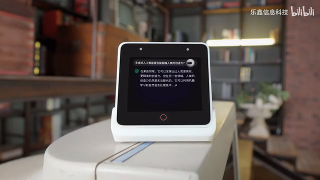
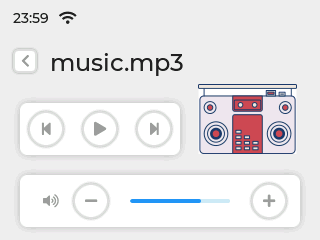

# BOX-3 资料归档与视觉参考

归档日期：2026-10-21。资料保存在独立 `esp-box3` 项目，供后续开发使用；不是临时浏览器缓存，也不表示所列官方能力已经移植。

完整实施顺序见[整体技术计划](../../ESP_BOX3_EZ_TECHNICAL_PLAN.md)；原设备接入见[历史部署记录](../../deployments/2026-10-20-box3-ez.md)，`.13` 官方小球动画及无声启动核验见[动画部署记录](../../deployments/2026-10-21-box3-robot.md)。

## 已确认的视觉偏好与来源

用户喜欢官方宣传视频 **00:53–00:55** 的小球机器人效果，将其设为第一屏的首选视觉参考。它属于乐鑫官方 `examples/chatgpt_demo`，与 `factory_demo` 的麦克风柱条、`esp_emote_assets` 的双眼动画、78 默认 Noto PNG 三套效果分别记录。

对应官方提交 `aae1b7a6d193d968cf53e42f291a60c4ca1c622c`：

- [状态与面板切换](sources/esp-box/examples/chatgpt_demo/main/app/app_ui_ctrl.c)：`SLEEP`、`LISTEN`、`GET`、`REPLY` 四态。
- [动画函数](sources/esp-box/examples/chatgpt_demo/main/ui/ui.c)：待机小球上下起伏、聆听眨眼、眼屏移动、处理时眨眼。
- [界面与原图数组](sources/esp-box/examples/chatgpt_demo/main/ui/screens/ui_ScreenListen.c)、[图像资源目录](sources/esp-box/examples/chatgpt_demo/main/ui/images/)：回复面板顶部问题、右上静态小机器人、下方回复正文。
- [主流程](sources/esp-box/examples/chatgpt_demo/main/main.c)：先显示完整回复、切换回复面板，再进行 TTS；不是逐字流式字幕。

源码标明使用 SquareLine Studio 1.3.0 / LVGL 8.3.4。SquareLine 是开发工具，不是把美术作者归属给该工具；可确认的是界面由 Espressif 官方仓库发布。素材保留上游声明和[项目许可证](sources/esp-box/LICENSE)。迁移界面不意味着改用 OpenAI 后端，BOX-3 继续连接 EZ。

## 官方画面截图

以下均直接截取自[乐鑫信息科技官方视频](https://www.bilibili.com/video/BV11N4y197Qu/)，未重画或放大。完整原视频、本地 SHA-256 和来源说明保存在 `previews/factory/`；逐图时间点和校验保存在 [截图清单](media/screenshots/manifest.json)。

### 待机：00:48

### 聆听：00:53

### 眨眼变化：00:54.5

### 回复：00:56.5

回复时隐藏大机器人动画面板，显示问题和答案，仍保留右上角小机器人静态图。官方代码在播放开始后按行滚动正文，文字滚完且音频结束后回待机；迁移至 EZ 时需保持当前连续对话，而不是照搬固定回待机。

### 原厂 Media Player

此图来自官方中文入门文档，是计划中最后一屏的功能参考；不与上述 ChatGPT demo 主屏混为同一个固件界面。

## 资料目录

| 目录 | 内容与用途 |
| --- | --- |
| `official-docs/` | 用户先前提供的三份官方资料正文、网页及原来源清单 |
| `sources/esp-box/` | 官方 ChatGPT demo 主程序、完整 UI/图像/字体，factory_demo GUI，以及 BOX-3 硬件说明、传感器实现与根许可证 |
| `sources/esp-bsp/` | 固定提交的触摸、按键、引脚与传感器 BSP 参考 |
| `sources/xiaozhi-esp32/` | 固定提交的 BOX-3、打断、显示、音量及消息协议参考 |
| `sources/agent-robot/` | EZ 正式终端通信协议，不复制运行配置 |
| `sources/esp_emote_assets/` | 安装版本 0.1.2 的 EAF、图标、分辨率布局与元数据，作为可选动画来源 |
| `sources/esp_emote_gfx/`、`sources/esp_emote_expression/` | 实际依赖的解码/表达接口、说明及许可证 |
| `previews/emote/` | 原始 EAF 解码后的动图与本地预览，不是设备实录 |
| `previews/factory/` | 官方原视频、原图、源码及检查截图；视频也包含其他示例，不能把所有画面都当作 factory_demo |
| `media/screenshots/` | 用户选定视觉及回复面板的官方视频原帧 |
| `manifest.json` | 公共资料逐文件来源、提交/版本、大小和 SHA-256；预览页的项目相对路径调整另作标记 |

为避免再次依赖旧项目目录，之前的 Bridge 相关代码快照、EZ 连接录屏与调研、EZ Host 源码参考已复制到本项目 `local-references/esp-box3/`。它们保留在本地、被 Git 忽略，另有逐文件校验。Provider 密钥、运行配置、NVS 与设备日志不属于本次公共资料归档，仍留在既有私有备份。

本机预览可从本目录运行 `python3 -m http.server 18747 --bind 127.0.0.1`，访问 `/previews/factory/` 和 `/previews/emote/`。不需要联网或刷机即可回看已保存资料。
